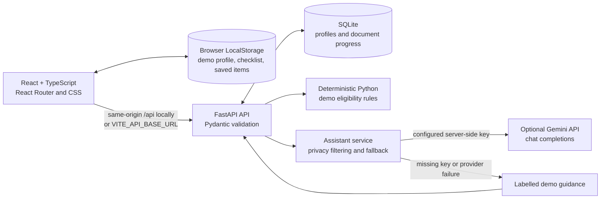

# Sapna Saathi — Rural Scholarship Assistant

Sapna Saathi is a mobile-first hackathon prototype that helps rural students explore scholarship application steps. It brings profile capture, illustrative opportunity matching, a document checklist, and a simple text/voice help screen into one guided experience.

> **Demo notice:** Scholarship names, providers, benefits, amounts, criteria, and eligibility outcomes in this project are mock examples. They are not verified offers, current rules, or government services. Confirm requirements with the official provider before applying.

## The problem

Students may have difficulty finding opportunities, understanding application documents, and knowing what to do next. Information can be spread across notices and support offices, while access to reliable guidance varies by location.

## The prototype

Sapna Saathi demonstrates a simple journey from a student profile to mock opportunity results, then to an application checklist and optional guidance. It is intended for demos and feedback, not to make official decisions or submit applications.

### Features in the code

- **Scholarship discovery:** displays sample opportunities with mock amounts and criteria clearly labeled. The results page provides filters for all opportunities, possible demo matches, explore-more items, and saved items.
- **Deterministic eligibility checks:** the FastAPI backend applies explicit Python demo rules. If the backend is unavailable, the frontend can show local illustrative estimates. AI does not decide or override eligibility.
- **Student profile:** collects basic education and demographic fields used by the prototype. Profile progress is stored in browser LocalStorage and can sync to SQLite through the API.
- **Document checklist:** tracks checklist completion, shows why a document may be requested, suggested next steps, and illustrative prerequisites. Requirements are unverified demo guidance.
- **Assistant guidance:** text questions and document guidance use the backend. With an API key and provider configuration, the backend can call an OpenAI-compatible chat-completions endpoint; otherwise, it returns labeled demo fallback guidance. No successful live Gemini response has been verified for this repository.
- **Voice help:** uses browser speech recognition and speech synthesis only where the browser supports them; text remains available as a fallback.
- **Gramin Kalyan guide:** provides in-app informational navigation and demo guidance. It does not connect to government services.
- **Responsive interface:** the React app includes home, student details, results, documents, voice help, and Gramin Kalyan screens.

## Demo and screenshots

No public deployment URL or verified product screenshots are included yet.

- **Live demo:** _Not deployed._
- **Home screen:** _Screenshot placeholder — add a current application screenshot._
- **Opportunity results:** _Screenshot placeholder — add a current application screenshot._
- **Document checklist:** _Screenshot placeholder — add a current application screenshot._

The original Stitch design folders are preserved in the repository as design references.

## Technology

- **Frontend:** React, TypeScript, Vite, React Router, Lucide icons, and CSS.
- **Backend:** Python, FastAPI, Pydantic request models, and SQLite.
- **Assistant provider:** optional Gemini API through Google's OpenAI-compatible chat-completions endpoint; the URL and model are configurable. Without provider configuration, requests use demo fallback responses.
- **Local persistence:** browser LocalStorage and SQLite for demo profiles and document progress.
- **Tests/build:** Python `unittest` and the Vite production build (`tsc -b && vite build`).

## Architecture



The browser sends only the limited assistant context accepted by the backend (education level, course, rural status, and completed document IDs). The AI service does not receive profile name, district, income, or age. Never put provider keys in `VITE_*` variables: those values are compiled into client-side assets.

## Repository layout

```text
.
├── frontend/
│   ├── src/App.tsx
│   ├── src/services/api.ts
│   ├── src/styles.css
│   ├── package.json
│   └── vite.config.ts
├── backend/
│   ├── main.py
│   ├── ai_service.py
│   ├── requirements.txt
│   └── tests/test_assistant.py
├── gramin_kalyan/                         # Original Stitch design
├── sapna_saathi_home_screen_1/            # Original Stitch design
├── sapna_saathi_student_details_screen_2/  # Original Stitch design
├── sapna_saathi_results_screen_3/          # Original Stitch design
├── sapna_saathi_documents_screen_4/        # Original Stitch design
├── sapna_saathi_voice_help_screen_5/       # Original Stitch design
├── .env.example                            # Blank server-key placeholder
└── README.md
```

## Requirements

- Windows 10/11, macOS, or Linux.
- Python 3.10 or newer. Python 3.11 is used for the tested local environment.
- Node.js 20.19+ or 22.12+, plus npm. The checked local environment uses Node 24.14.1. [Vite's current Node.js requirements](https://vite.dev/guide/).
- Git for cloning and version control.

## Run locally on Windows PowerShell

Open two PowerShell terminals at the repository root.

### 1. Start the backend

```powershell
py -3.11 -m venv backend\.venv
backend\.venv\Scripts\python.exe -m pip install --upgrade pip
backend\.venv\Scripts\python.exe -m pip install -r backend\requirements.txt
backend\.venv\Scripts\python.exe -m uvicorn main:app --app-dir backend --reload --host 127.0.0.1 --port 8000
```

The API is at `http://127.0.0.1:8000`; interactive Swagger documentation is at `http://127.0.0.1:8000/docs`.

### 2. Start the frontend

```powershell
Set-Location frontend
npm ci
npm run dev
```

Open the Vite URL shown in the terminal, normally `http://localhost:5173`. During development, Vite proxies `/api` to `http://127.0.0.1:8000`.

## Environment configuration

The backend reads environment variables from its process. It does **not** automatically load a `.env` file. The root `.env.example` has a blank API-key placeholder and example Gemini settings; it is not itself loaded by FastAPI. Set variables in the same shell that starts Uvicorn.

| Variable | Purpose | Local example |
| --- | --- | --- |
| `SAPNA_AI_API_KEY` | Optional server-side Gemini API key. Leave unset to use demo fallback. | Set securely in PowerShell; never commit it. |
| `SAPNA_AI_BASE_URL` | Configurable OpenAI-compatible chat-completions URL. | `https://generativelanguage.googleapis.com/v1beta/openai/chat/completions` |
| `SAPNA_AI_MODEL` | Gemini model ID. | `gemini-3.8-flash` |
| `SAPNA_CORS_ORIGINS` | Comma-separated exact browser origins allowed to call this backend. | `http://localhost:5173,http://127.0.0.1:5173` |
| `SAPNA_SAATHI_DB` | Optional SQLite database file location. | Defaults to `backend/sapna_saathi.db`. |
| `VITE_API_BASE_URL` | Optional frontend API root, including `/api`; this is a public URL, not a secret. | Blank locally; Vite uses `/api`. |

Google's official guide documents this endpoint and the `gemini-3.8-flash` model ID. [Gemini API OpenAI compatibility](https://ai.google.dev/gemini-api/docs/openai). Create a key through [Google AI Studio](https://aistudio.google.com/).

To set up Gemini in PowerShell without echoing the key while entering it:

```powershell
$secureKey = Read-Host "Gemini API key" -AsSecureString
$keyPointer = [Runtime.InteropServices.Marshal]::SecureStringToBSTR($secureKey)
try { $env:SAPNA_AI_API_KEY = [Runtime.InteropServices.Marshal]::PtrToStringBSTR($keyPointer) }
finally { [Runtime.InteropServices.Marshal]::ZeroFreeBSTR($keyPointer) }
$env:SAPNA_AI_BASE_URL = "https://generativelanguage.googleapis.com/v1beta/openai/chat/completions"
$env:SAPNA_AI_MODEL = "gemini-3.8-flash"
```

Then start or restart Uvicorn from that terminal. The integration has mocked request tests, but no successful live Gemini response has been verified. Provider failures return labeled demo guidance. Do not paste keys into source files, browser settings, issues, or chat messages.

## API endpoints

| Method and path | Description |
| --- | --- |
| `GET /api/health` | Demo API health check. |
| `GET /api/opportunities` | Returns mock scholarship opportunities. |
| `POST /api/eligibility/check` | Evaluates supplied profile against deterministic demo rules. |
| `GET /api/profile/{student_id}` | Retrieves a saved profile. |
| `PUT /api/profile/{student_id}` | Validates and saves a profile. |
| `GET /api/documents/{student_id}` | Retrieves checklist progress. |
| `PUT /api/documents/{student_id}` | Saves checklist progress. |
| `POST /api/assistant/chat` | Returns assistant or labeled demo-fallback guidance. |
| `POST /api/assistant/guidance` | Returns guidance for a supported document ID. |

Schemas and interactive request examples are available at `http://127.0.0.1:8000/docs` while the local backend is running. The profile and checklist routes have no authentication; the API is a local demo.

## Tests and production build

From the repository root, run backend tests:

```powershell
backend\.venv\Scripts\python.exe -m unittest discover -s backend/tests -v
```

Build the frontend:

```powershell
Set-Location frontend
npm run build
```

The frontend output is written to `frontend/dist/` and is ignored by Git.

## Separate frontend/backend deployment

The app can be configured for separate hosting using the frontend API root and backend CORS origins:

1. Deploy the FastAPI backend to a Python host that can run Uvicorn. Install `backend/requirements.txt`, then start it with the host-provided port and `--host 0.0.0.0` (for example, `uvicorn main:app --app-dir backend --host 0.0.0.0 --port $PORT`). Configure server-side `SAPNA_AI_API_KEY`, `SAPNA_AI_BASE_URL`, `SAPNA_AI_MODEL`, and `SAPNA_CORS_ORIGINS` in that hosting provider's secret/environment settings.
2. Set `SAPNA_CORS_ORIGINS` to the exact deployed frontend origin, such as `https://your-app.example.com` (scheme and host only, no path). For multiple frontends, comma-separate their origins. Do not use `*` for a public deployment.
3. Build the frontend with `VITE_API_BASE_URL` set to the backend's public API root including `/api`, for example `https://your-api.example.com/api`.
4. Publish `frontend/dist/` on a static frontend host. Configure its SPA fallback so application routes such as `/voice` and `/documents` serve `index.html`.
5. Verify the deployed `/api/health` endpoint and browser requests from the deployed frontend origin.

The frontend API URL is public build configuration; the AI key remains server-side. SQLite requires persistent storage on the backend host or records may disappear when an instance restarts. This prototype has no authentication and should not be exposed for real personal or financial data without further security work. No deployment URL is currently available or verified.

## Limitations and future work

- Scholarship records and eligibility criteria are fictional mock data; no scholarship provider, deadline, funding amount, or official rule is verified.
- Eligibility rules are simple deterministic demonstration rules, not official decisions.
- Gemini fallback is tested, but a successful live provider response has not been confirmed.
- Speech recognition and speech synthesis depend on browser support, user permissions, and connectivity.
- There is no authentication, authorization, production database migration strategy, account recovery, or application submission.
- Future work could add verified source links and update dates, accessibility and localization review, secure user accounts, persistent managed storage, and deployment monitoring.

## Security and privacy

- Never commit `.env` files, API keys, credentials, local SQLite data, virtual environments, caches, or build artifacts. `.gitignore` excludes these; `.env.example` is an example template only.
- Keep `SAPNA_AI_API_KEY` in the backend host's secret manager or backend process environment. Never set it as a `VITE_*` variable.
- Assistant context is restricted to education level, course, rural status, and completed document IDs. Avoid sending personal or sensitive data in questions.
- The prototype saves profile/checklist demo data in browser LocalStorage and SQLite. Do not enter Aadhaar numbers, bank details, passwords, or other sensitive identity information.
- Provider errors are logged with a code and short sanitized message; API keys, authorization headers, and submitted question/profile content must not be logged.
- No government service is connected, and no AI system makes eligibility decisions.

## Contributing

For changes, create a focused branch, keep the original Stitch design folders intact, update relevant documentation, run backend tests and the frontend production build, and open a pull request with a concise description of what changed.

## License

No `LICENSE` file is present, so this repository does not currently declare an open-source license. Contact the project owner before reusing or redistributing the code or design assets.
